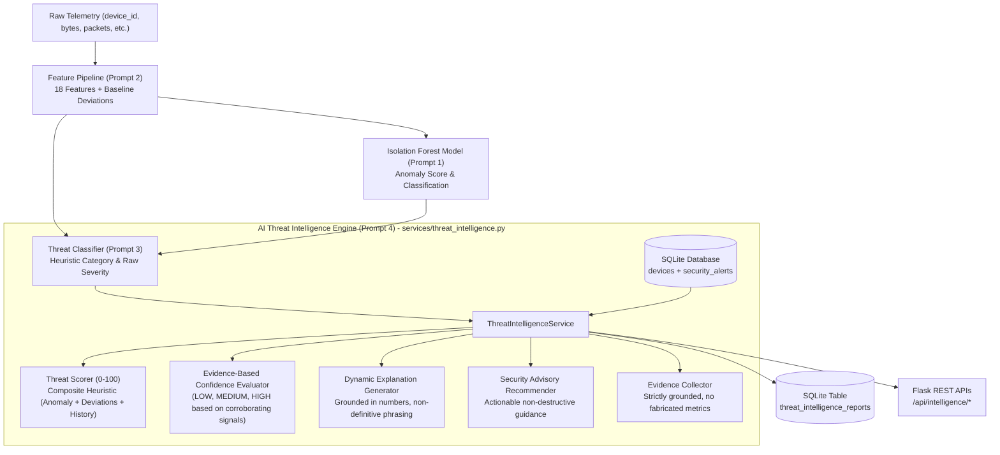

# NETGUARDIAN AI – AI THREAT INTELLIGENCE ENGINE
## AI/ML Prompt 4 Technical Architecture & Verification Report
**System Tagline:** *Detect. Defend. Recover. Automatically.*

---

## 1. Threat Intelligence Architecture Overview

The **NetGuardian AI Threat Intelligence Engine** serves as the cognitive reasoning and security advisory layer of the platform. It unifies outputs across all machine learning and data engineering stages to produce structured, grounded, and non-destructive cybersecurity threat intelligence.



### Component Synergy
1. **Prompt 1 (Anomaly Detection):** Provides multidimensional unsupervised outlier detection via an 18-feature Isolation Forest (`anomaly_score` $\in [0, 1]$).
2. **Prompt 2 (Feature Engineering):** Supplies statistical z-score deviations ($\sigma$-variations in volume, connection rate, entropy) and ratio metrics.
3. **Prompt 3 (Threat Classification):** Maps multivariate outliers into concrete security categories and manages duplicate alert suppression in `security_alerts`.
4. **Prompt 4 (Threat Intelligence):** Correlates real-time analysis with monitored device metadata and historical database incident records, producing composite threat scores, multi-factor confidence ratings, dynamic explanations, and non-destructive incident response guidance.

---

## 2. Threat Intelligence Categories & Wording

The engine recognizes 8 canonical threat indicators. In strict accordance with cybersecurity best practices, indicators are labeled with non-absolute terminology (*"Possible threat indicator"*, *"Suspicious traffic pattern"*, *"Potential security risk"*, *"Requires investigation"*):

| # | Threat Indicator | Operational Criteria | Non-Definitive Phrasing Example |
|---|---|---|---|
| 1 | **Port Scanning** | $conn\_freq \ge 60\text{/s} \land avg\_pkt\_size \le 150\text{B} \land ratio \le 0.35$ | *"This suspicious traffic pattern is a possible threat indicator of network reconnaissance and requires investigation."* |
| 2 | **DoS-like Traffic Spike** | $pps \ge 3500 \lor (pkts \ge 8000 \land avg \le 120\text{B} \land freq \ge 200)$ | *"This suspicious traffic pattern matches connection flood behavior, poses a potential security risk of service degradation, and requires investigation."* |
| 3 | **Suspicious Outbound Traffic** | $out\_pct \ge 70\% \land (out\_bytes \ge 1\text{MB} \lor vol\_dev \ge 2.5\sigma)$ | *"This behaviour may indicate suspicious data transfer activity and represents a potential security risk that requires investigation."* |
| 4 | **Potential Data Exfiltration** | $out\_pct \ge 85\% \land (entropy \ge 7.3 \lor out\_bytes \ge 5\text{MB})$ | *"This possible threat indicator suggests potential unauthorized data transfer and requires investigation."* |
| 5 | **Unusual Packet Behaviour** | $avg\_pkt\_size \ge 3500\text{B} \lor variation \ge 800 \lor entropy \ge 7.6$ | *"This suspicious traffic pattern deviates from standard communication profiles and represents a potential security risk requiring investigation."* |
| 6 | **Abnormal Connection Frequency** | $conn\_freq \ge 75\text{/s} \lor conn\_dev \ge 3.0\sigma$ | *"This possible threat indicator indicates rapid automated polling or beaconing activity and requires investigation."* |
| 7 | **Suspicious Network Communication** | Latent Isolation Forest outlier fallback ($is\_anomaly = \text{True}$) | *"This possible threat indicator deviates from established traffic baselines and requires investigation."* |
| 8 | **Repeated Anomalous Behaviour** | Anomaly detected on device with $\ge 2$ prior alerts in history | *"This persistent behavioural anomaly represents an escalating potential security risk and requires thorough investigation."* |

---

## 3. Threat Intelligence Scoring Methodology

The intelligence threat score ($S_{threat} \in [0, 100]$) is a composite heuristic risk index synthesized from three quantitative components:

$$S_{threat} = C_{anomaly} + C_{deviation} + C_{history}$$

### Scoring Components
1. **Base Anomaly Component ($C_{anomaly} \in [0, 45]$ points):**
   $$C_{anomaly} = \lfloor \min(\max(\text{score}_{anomaly}, 0.0), 1.0) \times 45 \rfloor$$
2. **Deviation Magnitude Component ($C_{deviation} \in [0, 30]$ points):**
   Evaluates the maximum absolute standard deviation deviation among engineered features:
   $$\delta_{max} = \max(|\sigma_{vol}|, |\sigma_{conn}|, |\sigma_{ent}|)$$
   - $\delta_{max} \ge 5.0\sigma \implies 30\text{ points}$
   - $\delta_{max} \ge 3.0\sigma \implies 22\text{ points}$
   - $\delta_{max} \ge 1.5\sigma \implies 12\text{ points}$
   - $\delta_{max} < 1.5\sigma \implies 4\text{ points}$
3. **Historical Recurrence Component ($C_{history} \in [0, 25]$ points):**
   - $\ge 3\text{ historical alerts} \implies 25\text{ points}$
   - $2\text{ historical alerts} \implies 18\text{ points}$
   - $1\text{ historical alert} \implies 10\text{ points}$
   - $0\text{ historical alerts} \implies 0\text{ points}$

### Severity Mapping (Configurable via `Config.THREAT_INTEL_SCORE_THRESHOLDS`)
- **CRITICAL:** Score $\ge 80$ (or extreme packet flood $pps \ge 10,000$)
- **HIGH:** Score $\ge 65$ (or `Repeated Anomalous Behaviour` floor)
- **MEDIUM:** Score $\ge 45$ (or any confirmed non-nominal anomaly floor)
- **LOW:** Score $< 45$ (standard for clean `Nominal Traffic` which scores $\le 25$)

---

## 4. Multi-Factor Confidence Level Calculation

Confidence is evaluated as `LOW`, `MEDIUM`, or `HIGH`. In strict compliance with Prompt 4 requirements, **confidence reflects the quantity and quality of supporting evidence**, rather than simply copying the anomaly score.

The engine tallies 7 independent corroborating evidence factors:
1. **Baseline Availability:** Pre-calculated mean ($\mu$) and standard deviation ($\sigma$) baselines are loaded.
2. **Volume Corroboration:** Traffic volume deviation $|\sigma_{vol}| \ge 2.0\sigma$.
3. **Connection Rate Corroboration:** Connection frequency deviation $|\sigma_{conn}| \ge 2.0\sigma$.
4. **Entropy Corroboration:** Shannon entropy deviation $|\sigma_{ent}| \ge 1.5\sigma$.
5. **Ratio Corroboration:** Outbound percentage $\ge 75\%$ or inbound-to-outbound ratio $\le 0.35$.
6. **Throughput Burst Corroboration:** Extreme frame rate $pps \ge 3,500\text{ pkts/sec}$.
7. **Historical Corroboration:** $\ge 1$ existing security alert recorded for this device.

**Confidence Classification:**
- **HIGH:** $\ge 3$ independent corroborating evidence factors present.
- **MEDIUM:** $1 - 2$ corroborating factors present.
- **LOW:** $0$ corroborating factors present.

---

## 5. Grounded Evidence Collection

Every intelligence analysis collects and returns available real telemetry and device metadata. **No metrics are fabricated or hallucinated:**

```json
"evidence": {
  "device_id": 3,
  "device_name": "Server 02",
  "device_ip": "192.168.1.11",
  "packet_count": 1800,
  "average_packet_size": 1200.0,
  "inbound_bytes": 100000,
  "outbound_bytes": 2060000,
  "connection_frequency": 25.0,
  "traffic_volume_deviation": 3.82,
  "anomaly_score": 0.5841,
  "threat_classification": "Suspicious Outbound Traffic",
  "detection_timestamp": "2026-11-18T07:55:12.104Z",
  "related_historical_alerts_count": 1,
  "related_historical_alert_codes": ["ALT-1002"]
}
```

---

## 6. Dynamic Threat Explanations & Security Advisories

### Dynamic Explanation Generation
Explanations are synthesized at runtime directly from actual telemetry values:
- *Example for PC 03 (Suspicious Outbound):*
  > *"Device 'PC 03' (192.168.1.22) transmitted unusually high outbound network traffic (2,060,000 bytes, 95.4% egress, 3.8σ deviation from baseline). This behaviour may indicate suspicious data transfer activity and represents a potential security risk that requires investigation."*
- *Example for Repeated Anomalous Behaviour:*
  > *"Device 'Server 01' (192.168.1.10) has demonstrated recurring anomalous traffic patterns across 3 security incidents in the monitoring window. This persistent behavioural anomaly represents an escalating potential security risk and requires thorough investigation."*

### Non-Destructive Security Recommendations
Recommendations return an ordered `List[str]`. No automated isolations or link terminations are executed in Prompt 4:
- **LOW Severity:**
  1. `"Continue routine monitoring of device telemetry."`
  2. `"Record the unusual behaviour in telemetry audit logs."`
- **MEDIUM Severity:**
  1. `"Investigate the device and review recent network socket activity."`
  2. `"Review recent traffic activity and host system logs."`
- **HIGH Severity:**
  1. `"Generate a high-priority security alert for SOC incident review."`
  2. `"Inspect outbound connections and evaluate destination IP reputations."`
  3. `"Consider simulated device isolation in the test network environment."`
- **CRITICAL Severity:**
  1. `"Generate a critical security incident alert immediately."`
  2. `"Recommend immediate investigation by SOC incident response team."`
  3. `"Recommend simulated isolation if supported by the existing network environment."`
- **Indicator-Specific Advisories:**
  - *DoS:* `"Evaluate perimeter rate-limiting and SYN flood controls on gateway."`
  - *Exfiltration:* `"Inspect egress payload entropy and block suspicious remote ports."`
  - *Scanning:* `"Inspect host sweep behavior and restrict egress port probes."`
  - *Repeated Anomalies:* `"Conduct deep behavioral forensic audit on device host processes."`

---

## 7. Historical Threat Analysis Engine

The historical analyzer inspects SQLite tables (`security_alerts` and `threat_intelligence_reports`).
- **Data Sufficiency Gate:** If total historical records $< 2$, it returns an explicit `insufficient_data` status rather than inventing false trends:
  ```json
  {
    "status": "insufficient_data",
    "message": "Insufficient historical threat data to identify recurring trends (minimum 2 historical records required).",
    "total_records": 0
  }
  ```
- **Sufficient Data Analysis:**
  - Identifies devices with recurring anomalies ($\ge 2$ alerts)
  - Computes indicator frequency rankings
  - Analyzes severity progression over time
  - Flags repeated high-risk incident patterns

---

## 8. Threat Intelligence REST API Endpoints

The endpoints are exposed under `/api/intelligence` via Flask Blueprint `intelligence_bp`:

| Method | Endpoint | Description | Status Codes |
|---|---|---|---|
| `GET` | `/api/intelligence/summary` | High-level intelligence metrics (total reports, mean score, top indicators, recurring devices) | 200, 500 |
| `GET` | `/api/intelligence/threats` | Filterable intelligence reports (`severity`, `threat_indicator`, `device_id`, `limit`, `offset`) | 200, 400, 500 |
| `GET` | `/api/intelligence/device/<id>` | Full intelligence profile for a device (history, avg score, severity distribution) | 200, 400, 404, 500 |
| `GET` | `/api/intelligence/history` | Historical trend analysis, recurring devices, and ranked indicators | 200, 500 |
| `POST` | `/api/intelligence/analyze` | Ingests live telemetry, performs intelligence synthesis, and persists report | 200, 400, 404, 500 |

### Sample Response (`POST /api/intelligence/analyze`):
```json
{
  "success": true,
  "message": "Threat intelligence analysis generated successfully",
  "data": {
    "device_id": 3,
    "device_name": "Server 02",
    "device_ip": "192.168.1.11",
    "threat_indicator": "Suspicious Outbound Traffic",
    "severity": "MEDIUM",
    "threat_score": 50,
    "confidence": "HIGH",
    "explanation": "Device 'Server 02' (192.168.1.11) transmitted unusually high outbound network traffic (2,060,000 bytes, 95.4% egress, 3.8σ deviation from baseline). This behaviour may indicate suspicious data transfer activity and represents a potential security risk that requires investigation.",
    "evidence": {
      "device_id": 3,
      "device_name": "Server 02",
      "device_ip": "192.168.1.11",
      "packet_count": 1800,
      "average_packet_size": 1200.0,
      "inbound_bytes": 100000,
      "outbound_bytes": 2060000,
      "connection_frequency": 25.0,
      "traffic_volume_deviation": 3.82,
      "anomaly_score": 0.5841,
      "threat_classification": "Suspicious Outbound Traffic",
      "detection_timestamp": "2026-11-18T07:55:12.104Z",
      "related_historical_alerts_count": 1,
      "related_historical_alert_codes": ["ALT-1002"]
    },
    "recommended_actions": [
      "Investigate the device and review recent network socket activity.",
      "Review recent traffic activity and host system logs.",
      "Review active egress sockets and compare against authorized baseline services."
    ],
    "alert_code": "ALT-1002",
    "timestamp": "2026-11-18T07:55:12.104Z"
  }
}
```

---

## 9. Database Architecture & Migrations

### New SQLite Table: `threat_intelligence_reports`
```sql
CREATE TABLE IF NOT EXISTS threat_intelligence_reports (
    id INTEGER PRIMARY KEY AUTOINCREMENT,
    report_id TEXT UNIQUE NOT NULL,
    device_id INTEGER NOT NULL,
    device_ip TEXT,
    device_name TEXT,
    threat_indicator TEXT NOT NULL,
    severity TEXT NOT NULL CHECK(severity IN ('LOW', 'MEDIUM', 'HIGH', 'CRITICAL')),
    threat_score INTEGER NOT NULL,
    confidence TEXT NOT NULL CHECK(confidence IN ('LOW', 'MEDIUM', 'HIGH')),
    explanation TEXT NOT NULL,
    evidence_json TEXT NOT NULL,
    recommended_actions_json TEXT NOT NULL,
    alert_code TEXT,
    created_at TIMESTAMP DEFAULT CURRENT_TIMESTAMP,
    FOREIGN KEY (device_id) REFERENCES devices(id) ON DELETE CASCADE
);
CREATE INDEX IF NOT EXISTS idx_intel_device_id ON threat_intelligence_reports (device_id);
CREATE INDEX IF NOT EXISTS idx_intel_threat_indicator ON threat_intelligence_reports (threat_indicator);
CREATE INDEX IF NOT EXISTS idx_intel_severity ON threat_intelligence_reports (severity);
CREATE INDEX IF NOT EXISTS idx_intel_created_at ON threat_intelligence_reports (created_at);
```
- **Data Safety:** The table is created conditionally using `IF NOT EXISTS` during database initialization. Existing tables (`devices`, `network_connections`, `security_alerts`, `recovery_logs`) and their relationships remain intact.

---

## 10. Verification & Test Results

### Dedicated Threat Intelligence Test Suite (`tests/test_threat_intelligence.py`)
All 16 test cases were executed and verified against an isolated test SQLite database:

| # | Test Scenario | Verified Behavior | Status |
|---|---|---|---|
| 1 | `test_01_normal_traffic_intelligence` | Clean traffic classified as `'Nominal Traffic'`, `LOW` severity, score $\le 35$ | **PASS** |
| 2 | `test_02_suspicious_outbound_traffic` | Outbound volume flags `'Suspicious Outbound Traffic'` / `'Potential Data Exfiltration'` | **PASS** |
| 3 | `test_03_abnormal_connection_frequency` | Connection frequency $95\text{ conn/s}$ triggers `'Abnormal Connection Frequency'` | **PASS** |
| 4 | `test_04_dos_like_traffic_spike` | Frame flood ($28k\text{ pps}$) triggers `'DoS-like Traffic Spike'`, `CRITICAL`, score $\ge 80$ | **PASS** |
| 5 | `test_05_repeated_anomalies` | Multiple historical alerts escalate classification to `'Repeated Anomalous Behaviour'` | **PASS** |
| 6 | `test_06_threat_score_calculation` | 0-100 composite scoring verified across nominal, moderate, and extreme tiers | **PASS** |
| 7 | `test_07_confidence_calculation` | Verifies $\ge 3$ factors $\to$ `HIGH`, $1-2$ factors $\to$ `MEDIUM`, $0$ factors $\to$ `LOW` | **PASS** |
| 8 | `test_08_evidence_generation` | Verifies presence of actual telemetry metrics, deviations, and alert history | **PASS** |
| 9 | `test_09_dynamic_threat_explanations` | Verifies dynamic metric substitution and non-definitive phrasing | **PASS** |
| 10 | `test_10_recommended_security_actions` | Verifies non-destructive recommendation lists tailored to indicators | **PASS** |
| 11 | `test_11_historical_threat_analysis` | Summarizes recurring anomalies, ranked indicators, and severity trends | **PASS** |
| 12 | `test_12_missing_historical_data` | Cleanly returns `insufficient_data` status when $< 2$ records exist | **PASS** |
| 13 | `test_13_invalid_device_id` | Verifies `NotFoundError` / HTTP 404 for non-existent device ID `999` | **PASS** |
| 14 | `test_14_invalid_api_input` | Verifies HTTP 400 Bad Request for non-JSON, empty, or missing telemetry | **PASS** |
| 15 | `test_15_flask_api_response_structure` | Verifies full compliance with Prompt 4 JSON envelope contract | **PASS** |
| 16 | `test_16_database_persistence` | Verifies report persistence to SQLite and retrievability via `/api/intelligence/*` | **PASS** |

### Complete Backend Regression Suite
```text
Ran 114 tests in 13.583s
OK (All 114 tests passed across 9 test suites)
```
- `test_health.py`: 4 tests passed
- `test_devices.py`: 15 tests passed
- `test_simulation.py`: 12 tests passed
- `test_recovery.py`: 17 tests passed
- `test_integration.py`: 15 tests passed
- `test_anomaly_detection.py`: 13 tests passed
- `test_feature_engineering.py`: 9 tests passed
- `test_threat_classification.py`: 13 tests passed
- `test_threat_intelligence.py`: 16 tests passed

---

## 11. Known Limitations & Alignment for Prompt 5

1. **Non-Destructive by Design:** The Threat Intelligence Engine purposefully does not execute device isolations or traffic rerouting. This provides a strict separation of concerns, preserving all self-healing execution for the Self-Healing Engine (Prompt 5).
2. **Cold-Start History:** When the database is newly initialized, historical trends will report `insufficient_data` until at least 2 security alerts or intelligence reports have been recorded.
3. **Simulated Telemetry:** Analysis operates on simulated network devices and synthetic traffic metrics generated locally; no physical network devices are monitored or impacted.
