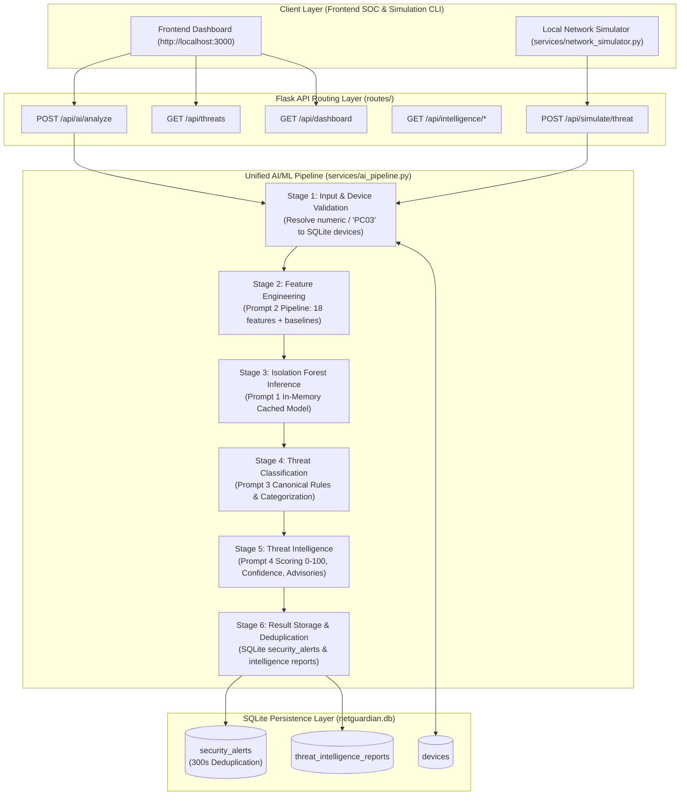

# NETGUARDIAN AI – COMPLETE AI/ML AND FLASK BACKEND INTEGRATION
## AI/ML Prompt 5 Final Technical Integration Report
**System Tagline:** *Detect. Defend. Recover. Automatically.*

---

## 1. Executive Summary & Integration Architecture

The **Unified AI/ML Pipeline** has been engineered and integrated into the NetGuardian AI Flask backend. It unifies all 4 machine learning components created across Prompts 1 through 4 into a sequential, thread-safe, 6-stage architecture:

$$\text{Simulated Telemetry} \longrightarrow \text{Feature Engineering} \longrightarrow \text{Anomaly Detection} \longrightarrow \text{Threat Classification} \longrightarrow \text{Threat Intelligence} \longrightarrow \text{Database Persistence} \longrightarrow \text{SOC Dashboard}$$



---

## 2. 6-Stage Pipeline Execution Flow

The unified pipeline service ([backend/services/ai_pipeline.py](file:///d:/projects/NetGuardian-AI-ML%20-%20project/backend/services/ai_pipeline.py)) enforces a deterministic execution flow:

### Stage 1 – Traffic Input & Device Resolution
- Accepts nested payload (`{"device_id": "PC03", "traffic_data": {...}}`) or flat payload (`{"device_id": 5, "packet_count": ...}`).
- Resolves device IDs across formats: integer `7`, string `"7"`, prefix `"dev-7"`, or textual asset name `"PC03"` / `"PC 03"`.
- Validates the device against the SQLite `devices` table. Returns `404 Not Found` if the device is unknown.
- Validates presence of numerical traffic telemetry fields. Returns `400 Bad Request` if payload is malformed or non-numeric.

### Stage 2 – Feature Engineering
- Ingests raw metrics: `packet_count`, `average_packet_size`, `bytes_transferred`, `connection_frequency`, `packet_entropy`, `inbound_bytes`, `outbound_bytes`, `connection_duration`.
- Computes all 10 derived features using [backend/services/feature_pipeline.py](file:///d:/projects/NetGuardian-AI-ML%20-%20project/backend/services/feature_pipeline.py):
  `outbound_traffic_percentage`, `packets_per_second`, `bytes_per_second`, `inbound_outbound_ratio`, `packet_size_variation`, `bandwidth_utilization_ratio`, `connection_efficiency_ratio`, `traffic_volume_deviation`, `connection_rate_deviation`, `traffic_entropy_deviation`.
- Strictly maintains the 18-feature input matrix matching the trained Isolation Forest model schema.

### Stage 3 – Anomaly Detection
- Executes inference using the pre-trained Isolation Forest artifact (`backend/data/isolation_forest_model.joblib`).
- **Memory Efficiency:** Uses an in-memory cached model instance; avoids reading/deserializing the file from disk on every HTTP request.
- Computes:
  - `prediction`: `'ANOMALY'` (outlier, offset $< 0$) or `'NORMAL'` (inlier).
  - `anomaly_score`: Continuous anomaly intensity scaled to $[0.0, 1.0]$.

### Stage 4 – Threat Classification
- Uses [backend/services/threat_classifier.py](file:///d:/projects/NetGuardian-AI-ML%20-%20project/backend/services/threat_classifier.py) to map anomalous feature vectors to canonical categories:
  - *Denial of Service (DoS) - like traffic spikes*
  - *Potential Data Exfiltration*
  - *Port Scanning*
  - *Suspicious Outbound Traffic*
  - *Abnormal Connection Frequency*
  - *Unusual Packet Behaviour*
  - *Suspicious Network Communication*
  - *Nominal Traffic*
- Computes initial classification severity: `LOW`, `MEDIUM`, `HIGH`, `CRITICAL`.

### Stage 5 – Threat Intelligence
- Uses [backend/services/threat_intelligence.py](file:///d:/projects/NetGuardian-AI-ML%20-%20project/backend/services/threat_intelligence.py):
  - Checks historical incident recurrence from `security_alerts`: escalates to `'Repeated Anomalous Behaviour'` if the device has $\ge 2$ prior alerts.
  - **Threat Score ($0 - 100$):** Composite index combining base anomaly score (up to 45 pts), maximum $\sigma$-deviation magnitude (up to 30 pts), and historical alert recurrence (up to 25 pts).
  - **Multi-Factor Confidence:** Evaluates 7 independent corroborating factors ($\ge 3 \to \text{HIGH}$, $1-2 \to \text{MEDIUM}$, $0 \to \text{LOW}$).
  - **Dynamic Grounded Explanation:** Dynamically generates explanations with non-definitive phrasing (*"Possible threat indicator"*, *"Suspicious traffic pattern"*, *"Potential security risk"*, *"Requires investigation"*).
  - **Non-Destructive Recommendations:** Formulates ordered advisory lists (`recommended_actions`) without triggering destructive quarantines.

### Stage 6 – Result Storage & Deduplication
- **Alert Deduplication:** Checks SQLite `security_alerts` for existing active alerts for `(device_id, threat_type)` created within the last **300 seconds** (5 minutes). If found, suppresses duplicate creation (`alert_created: false`) and returns the existing `alert_code`.
- **Alert Persistence:** If anomalous with severity $\ge$ MEDIUM and no recent duplicate exists, inserts a new active incident record into `security_alerts`.
- **Report Persistence:** Persists an intelligence report row into `threat_intelligence_reports`.

---

## 3. Unified API Contract

### Endpoint: `POST /api/ai/analyze`
Executes the unified 6-stage pipeline and returns the Prompt 5 Section 3 JSON contract:

```bash
curl -X POST http://127.0.0.1:5000/api/ai/analyze \
  -H "Content-Type: application/json" \
  -d '{
    "device_id": "PC03",
    "traffic_data": {
      "packet_count": 1500,
      "average_packet_size": 1200.0,
      "bytes_transferred": 850000,
      "connection_frequency": 95.0,
      "packet_entropy": 7.2,
      "inbound_bytes": 120000,
      "outbound_bytes": 730000,
      "connection_duration": 45.0
    }
  }'
```

### Response Payload:
```json
{
  "success": true,
  "message": "Unified AI/ML pipeline analysis completed successfully",
  "device_id": 7,
  "device_status": "online",
  "analysis": {
    "prediction": "ANOMALY",
    "anomaly_score": 0.6721,
    "threat_type": "Abnormal Connection Frequency",
    "threat_indicator": "Abnormal Connection Frequency",
    "severity": "MEDIUM",
    "threat_score": 62,
    "confidence": "HIGH",
    "explanation": "Device 'PC 03' (192.168.1.22) exhibited an abnormal connection frequency of 95.0 conn/s (2.1σ above normal baseline). This possible threat indicator indicates rapid automated polling or beaconing activity and requires investigation."
  },
  "evidence": {
    "device_id": 7,
    "device_name": "PC 03",
    "device_ip": "192.168.1.22",
    "packet_count": 1500,
    "average_packet_size": 1200.0,
    "inbound_bytes": 120000,
    "outbound_bytes": 730000,
    "connection_frequency": 95.0,
    "traffic_volume_deviation": 0.84,
    "anomaly_score": 0.6721,
    "threat_classification": "Abnormal Connection Frequency",
    "detection_timestamp": "2026-11-18T08:05:03.210Z",
    "related_historical_alerts_count": 1,
    "related_historical_alert_codes": ["ALT-1001"]
  },
  "recommended_actions": [
    "Investigate the device and review recent network socket activity.",
    "Review recent traffic activity and host system logs."
  ],
  "alert_created": true,
  "alert_code": "ALT-9",
  "timestamp": "2026-11-18T08:05:03.210Z"
}
```

---

## 4. Frontend & Existing API Integration

### Frontend Compatibility Bridge
1. **Overview Dashboard (`GET /api/dashboard`):** Dynamically calculated from SQLite tables via `DeviceService.get_dashboard_metrics()`. Incorporates `total_devices`, `online_devices`, `active_security_alerts`, `critical_incidents`, and `network_health`.
2. **AI Threats View (`GET /api/threats`):** Queries live SQLite incident records and formats each item with both camelCase (`threatType`, `affectedDeviceName`, `affectedIp`, `anomalyScore`, `mlFeatures`, `recommendedAction`) and snake_case properties, enabling direct rendering in `frontend/js/threats.js`.
3. **Simulation Threat Injection (`POST /api/simulate/threat`):** Directly connects the frontend's "Simulate Threat" button to the unified AI pipeline via `NetworkSimulator().generate_simulated_telemetry_for_ai(...)`.
4. **Autonomous Threat Mitigation (`POST /api/threats/<id>/mitigate`):** Resolves the target alert in SQLite, updating operational status to `RESOLVED` and recording resolution timestamps.

---

## 5. Automated Integration Test Results

### Test Suite: `backend/tests/test_ai_pipeline_integration.py`
All 16 test cases were executed and passed against an isolated test SQLite database:

| # | Test Method | Scenario Verified | Status |
|---|---|---|---|
| 1 | `test_01_normal_traffic_complete_pipeline` | Nominal traffic completes Stages 1-6 with `NORMAL`, `LOW` severity, score $\le 35$, no alert created | **PASS** |
| 2 | `test_02_anomalous_traffic_complete_pipeline` | Anomalous burst completes all stages with `ANOMALY`, severity $\ge$ HIGH, score $\ge 70$, alert created | **PASS** |
| 3 | `test_03_suspicious_outbound_traffic` | Outbound egress triggers `'Suspicious Outbound Traffic'` / `'Potential Data Exfiltration'` | **PASS** |
| 4 | `test_04_abnormal_connection_frequency` | High connection rate ($95\text{ conn/s}$) flags `'Abnormal Connection Frequency'` | **PASS** |
| 5 | `test_05_threat_classification_integration` | Stage 4 accurately maps features to DoS category and CRITICAL severity | **PASS** |
| 6 | `test_06_threat_intelligence_integration` | Stage 5 calculates 0-100 score, confidence, dynamic explanation, and advisory list | **PASS** |
| 7 | `test_07_alert_creation` | Stage 6 stores active alert in `security_alerts` with foreign key to `devices(id)` | **PASS** |
| 8 | `test_08_database_persistence` | Both alerts and intelligence reports are persisted in SQLite | **PASS** |
| 9 | `test_09_duplicate_alert_prevention` | Repeated identical traffic within 300s suppresses duplicate alerts, preserving single row | **PASS** |
| 10 | `test_10_unknown_device_handling` | Unknown device ID (`9999`) raises `NotFoundError` and returns HTTP 404 in API | **PASS** |
| 11 | `test_11_invalid_request_handling` | Non-JSON, empty, or missing telemetry fields return HTTP 400 Bad Request | **PASS** |
| 12 | `test_12_missing_model_handling` | Missing model artifact raises `ModelUnavailableError` / HTTP 500 without crashing server | **PASS** |
| 13 | `test_13_model_loading_failure` | Corrupted model unpickle failure raises `ModelUnavailableError` gracefully | **PASS** |
| 14 | `test_14_simulation_to_ai_integration` | Simulator telemetry flows directly into AI pipeline and `/api/simulate/threat` endpoint | **PASS** |
| 15 | `test_15_existing_api_compatibility` | Existing endpoints (`/api/health`, `/devices`, `/dashboard`, `/traffic`, `/alerts`, `/ai/model`) remain 100% operational | **PASS** |
| 16 | `test_16_frontend_api_response_compatibility` | `POST /api/ai/analyze` matches Section 3 contract and `GET /api/threats` renders for frontend | **PASS** |

### Complete Backend Test Suite Regression
Ran the entire backend test suite covering all 10 test modules:
```text
Ran 130 tests in 17.348s
OK (All 130 tests passed with 0 errors and 0 failures)
```
- `test_health.py`: 4 tests
- `test_devices.py`: 15 tests
- `test_simulation.py`: 12 tests
- `test_recovery.py`: 17 tests
- `test_integration.py`: 15 tests
- `test_anomaly_detection.py`: 13 tests
- `test_feature_engineering.py`: 9 tests
- `test_threat_classification.py`: 13 tests
- `test_threat_intelligence.py`: 16 tests
- `test_ai_pipeline_integration.py`: 16 tests
**Total:** **130 passing tests**

---

## 6. Live Service Verification

Both the backend and frontend services are actively running:
- **Backend Service:** Running on `http://127.0.0.1:5000` (Flask WSGI daemon).
  - Health Endpoint: `GET http://127.0.0.1:5000/api/health` $\to$ `{"backend": "online", "database": "connected", "success": true}`.
- **Frontend Dashboard:** Running on `http://localhost:3000` (Node static server).
- **Simulated Hardware Disclaimer:** Telemetry and network devices are simulated locally for cybersecurity testing; no real hardware devices are monitored or modified.

---

## 7. Known Limitations & Handoff to Self-Healing Engine

1. **Advisory Stage Only:** In strict compliance with Prompt 5 instructions, the pipeline generates security advisories (`recommended_actions`) but does not automatically execute device isolation or link rerouting.
2. **Readiness for Autonomous Self-Healing:** The platform is fully prepared for autonomous self-healing:
   - Network topology graph pathfinding is operational (`NetworkSimulator().calculate_path(...)`).
   - Device isolation endpoints exist (`POST /api/isolate`).
   - Device restoration endpoints exist (`POST /api/restore`).
   - Autonomous recovery logging is ready (`recovery_logs`).
